<picture>
  <source media="(prefers-color-scheme: dark)" srcset="assets/terminal-dark.svg" />
  
</picture>

 

> **EN** &nbsp; Developer from Spain. I like turning ideas into real products: full web apps, small desktop tools that solve one problem well, and Minecraft server plugins, which is where I started. Lately I'm exploring on-chain gaming on **Solana**.
>
> **ES** &nbsp; Desarrollador de España. Me gusta convertir ideas en productos reales: apps web completas, pequeñas herramientas de escritorio que resuelven un problema bien y plugins para servidores de Minecraft, que es donde empecé. Ahora estoy explorando el gaming on-chain en **Solana**.

 

## What I build · Qué construyo

<picture>
  <source media="(prefers-color-scheme: dark)" srcset="assets/areas-dark.svg" />
  
</picture>

## Featured projects · Proyectos destacados

| | |
|---|---|
| 🗓️ **[luden.work](https://github.com/luden-sudo/luden.work)**  [Live ↗](https://luden.work) | Agenda, personal finance and order tracking in one bilingual web app. Agenda, finanzas personales y seguimiento de pedidos en una sola app web bilingüe. `TypeScript` `Next.js` `Supabase` |
| ◎ **[ClaimSolana](https://github.com/luden-sudo/ClaimSolana)** | Reclaim the SOL locked in empty token accounts. 0% fees, open source, non-custodial. Recupera el SOL bloqueado en cuentas de tokens vacías. Sin comisiones, código abierto y sin custodia. `TypeScript` `Next.js` `Solana` |
| ⛏️ **[MinecraftServerBuilder](https://github.com/luden-sudo/MinecraftServerBuilder)** | CLI that downloads and launches Paper, Spigot and Magma servers (1.8.8 → 1.20.1). CLI que descarga y arranca servidores Paper, Spigot y Magma (1.8.8 → 1.20.1). `Python` |
| ⚖️ **[MultaRoleplay](https://github.com/luden-sudo/MultaRoleplay)**  [SpigotMC ↗](https://www.spigotmc.org/resources/multa-roleplay.108668/) | Roleplay plugin to fine players and keep a full fine history. Plugin de roleplay para multar a jugadores y guardar todo su historial de multas. `Java` `Spigot` |
| 🎮 **[DiscordStatus](https://github.com/luden-sudo/DiscordStatus)** | Tiny Windows app to show any custom "Playing…" status on Discord. Mini app de Windows para mostrar cualquier estado "Jugando a…" en Discord. `Python` `Tkinter` |

## Stack

  

## GitHub

<picture>
  <source media="(prefers-color-scheme: dark)" srcset="https://github-readme-stats.vercel.app/api?username=luden-sudo&show_icons=true&hide_border=true&theme=github_dark&title_color=14F1A5&icon_color=A78BFA&ring_color=14F1A5&include_all_commits=true" />
  
</picture>
<picture>
  <source media="(prefers-color-scheme: dark)" srcset="https://github-readme-stats.vercel.app/api/top-langs/?username=luden-sudo&layout=compact&hide_border=true&theme=github_dark&title_color=14F1A5" />
  
</picture>

<picture>
  <source media="(prefers-color-scheme: dark)" srcset="https://streak-stats.demolab.com?user=luden-sudo&hide_border=true&theme=github-dark-blue&background=0D1117&ring=14F1A5&fire=A78BFA&currStreakLabel=14F1A5" />
  
</picture>

<picture>
  <source media="(prefers-color-scheme: dark)" srcset="https://github-readme-activity-graph.vercel.app/graph?username=luden-sudo&hide_border=true&bg_color=0D1117&color=8B949E&line=14F1A5&point=A78BFA&area=true&area_color=14F1A5" />
  
</picture>

 

**Let's talk · Hablemos** → [luden.work](https://luden.work)

